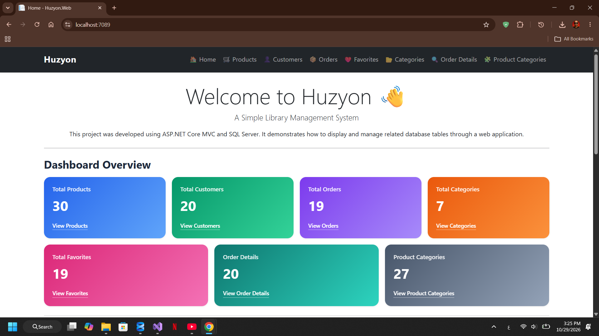
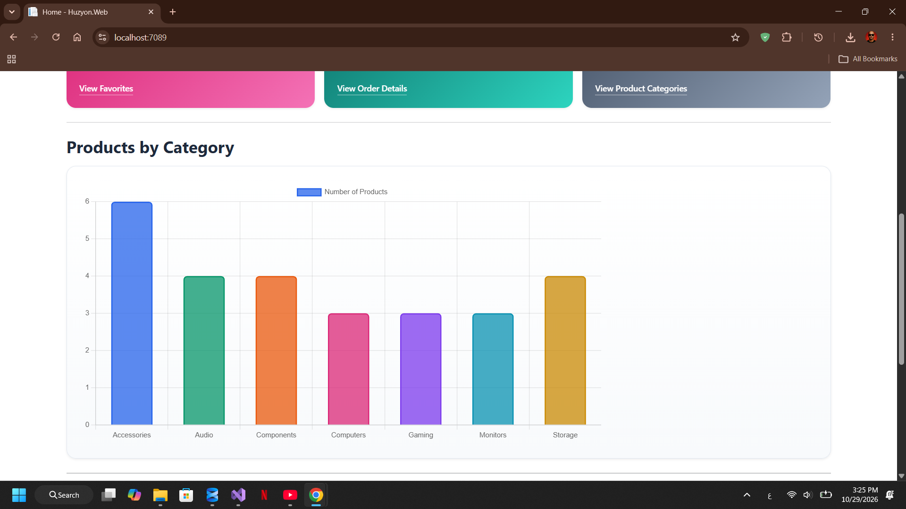
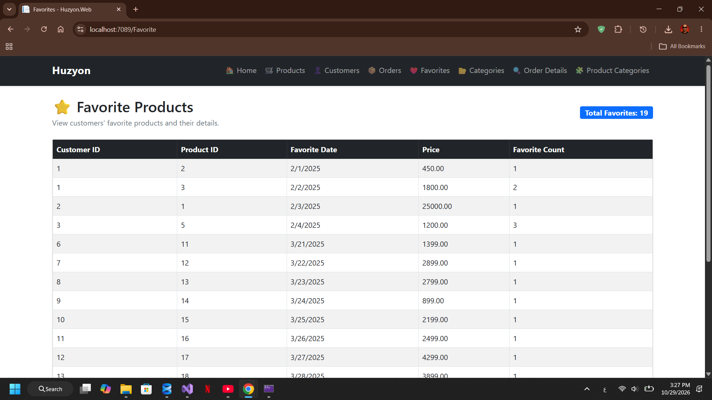

# Huzyon Library Web

A Library Management System built with ASP.NET Core MVC and SQL Server.

## About the Project

Huzyon Library is a web application developed to demonstrate how a library management system can display and organize data from related database tables.

The project uses ASP.NET Core MVC for the web interface and SQL Server for data storage. ADO.NET is used to retrieve database records through a Data Access Layer (DAL).

## Technologies Used

* C#
* ASP.NET Core MVC
* SQL Server
* ADO.NET
* HTML
* CSS
* JavaScript
* Bootstrap

## Features

* Dashboard with database record counts
* Product management views
* Customer data views
* Order and order details views
* Category views
* Favorites views
* Product-category relationships
* Products by category chart
* Navigation between the system's pages

## Project Structure

* `Huzyon.Models` — Class library containing the Data Access Layer and models.
* `Huzyon.Web` — ASP.NET Core MVC web application.
* `Database/HuzyonSql.sql` — SQL Server database script containing the database schema and sample data.
* `Huzyon.Web.sln` — Visual Studio solution.

## Database Setup

This project uses Microsoft SQL Server.

### 1. Create the Database

1. Open SQL Server Management Studio (SSMS).
2. Connect to your local SQL Server instance.
3. Open the `Database/HuzyonSql.sql` script from this repository.
4. Review the script and execute it to create the database objects and insert the sample data.

**Note:** The script may contain database creation and file configuration statements specific to the original environment. Review these settings and adjust them if necessary before execution.

### 2. Configure the Connection String

Open `Huzyon.Models/DAL/DbConfig.cs` and update the connection string to match your SQL Server instance and database name.

Example:

public static string ConnectionString =
    "Server=.\\SQLEXPRESS;Initial Catalog=HuzyonSql;Trusted_Connection=True;TrustServerCertificate=True;";

Adjust `Server` and the authentication settings to match your local SQL Server configuration.

### 3. Verify the Database

Make sure the database and its required tables have been created successfully before running the application.

## How to Run

1. Clone or download this repository.
2. Open `Huzyon.Web.sln` in Visual Studio 2022.
3. Configure the SQL Server connection string in `DbConfig.cs`.
4. Ensure the database and tables exist in SQL Server.
5. Build and run the `Huzyon.Web` project.

## Project Status

Developed as a learning project using ASP.NET Core MVC and SQL Server.

## Screenshots⬇️

### Dashboard

### Products by Category

### Database

